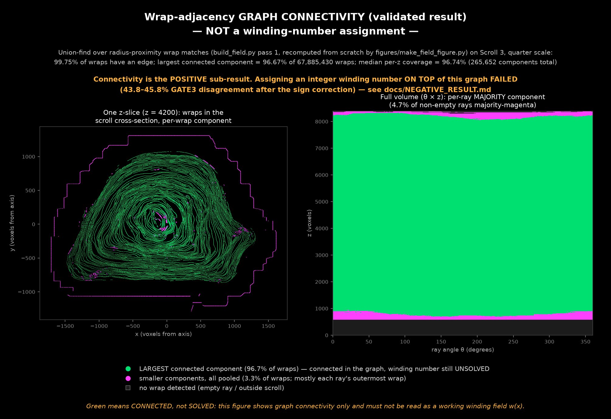

# Winding-field experiments for Herculaneum scrolls

This repository tests a global winding-coordinate construction over public
Scroll 3 surface predictions. Radial ray casting produces candidate sheet
crossings; radius-proximity matching connects crossings between neighboring
theta rays and z levels; global solvers then try to assign a consistent
winding coordinate.

> Companion write-up covering both this winding-assignment result and the
> related neural-tracer benchmark:
> https://github.com/LimeGS/winding-field/blob/main/WRITEUP.md

**Status (2026-07-10): the candidate graph is highly connected, but the
tested radius-proximity winding assignment is not accurate enough to ship as
a winding field.** The verified corrected result is 43.8-45.8% GATE3
same-sheet disagreement across three solver architectures plus one tolerance
sensitivity test. Segment audits aggregate to 21.525-26.637% transition
jumps; an independent segment scores 23.956%.

The first report overstated these failures because all solvers shared a sign
error (`+m` instead of `-m`). The original scripts, corrected twins, raw
logs, derivation, and known-truth test are retained so that correction is
auditable rather than hidden. See `docs/NEGATIVE_RESULT.md`.

## Verified graph result

`figures/make_field_figure.py` recomputes the graph from the raw radii and
refuses to render if its validation gates fail.

| Measurement | Recomputed result |
|---|---:|
| Wrap detections | 67,885,430 |
| Candidate theta/z edges | 126,878,516 |
| Wraps participating in at least one edge | 99.7527% |
| Largest connected component | 96.6671% |
| Median per-z largest-component coverage | 96.7406% |
| p10 per-z largest-component coverage | 62.9291% |
| Double-gap anomaly signature | 510,796 / 4,152,092 sampled gaps (12.3021%) |

These are connectivity and anomaly-census results. They do **not** prove
that every candidate edge joins the same physical sheet. The double-gap
census is also a heuristic that can reflect missing detections, merged
sheets, or local spacing variation; it is not an upper or lower bound on the
true segmentation-error rate.

An earlier exploratory note claimed zero conflicts in 75,888 redundant
edges. Its generator and log were not preserved, so that number has been
removed from the validated release claims.



## Winding-assignment result

The experiments cover three solver architectures, one matching-tolerance
sensitivity test, and one independent-segment replication:

| Experiment | Corrected GATE3 disagreement | Aggregate segment jumps |
|---|---:|---:|
| Confidence-priority spanning tree | 45.8% | 6,912 / 27,665 (24.985%) |
| Global weighted least-squares relaxation | 44.2% | 5,955 / 27,665 (21.525%) |
| Triangle-filtered spanning tree | 44.7% | 6,825 / 25,622 (26.637%) |
| Confidence tree, tighter nominal tolerance | 43.8% | 7,369 / 27,665 (26.637%) |
| Confidence tree, independent segment | - | 7,061 / 29,475 (23.956%) |

GATE3 is the fraction of matched candidate wrap pairs whose solved winding
values violate the expected same-sheet relation after accounting for the
theta seam. It is distinct from GATE1 vote purity. The segment metric is the
fraction of consecutive Viterbi-path transitions whose winding increment
deviates by more than 0.5 from the continuous angular increment.

The public audit now reports numerator, denominator, per-row rates, aggregate
rate, and endpoint residual. On Method 1 it reproduces
`6912/27665 = 24.985%`; its deterministic per-ray shuffle control gives
`24960/27665 = 90.222%`. That large degradation confirms that the readout
prior is not imposing the real field's lower jump rate.

## Correction record

The original solvers shared a sign error (offsets propagated with `+m`
where the coordinate construction requires `-m`), which inflated GATE3 to
68.5-70.5% and the segment audits to ~57-58%. Verified fix: a known-truth
synthetic spiral recovers 100% of winding labels under the corrected sign
(`python sign_convention_selftest.py`, 6 assertions), and the corrected
reruns preserve every sign-independent guard metric bit-for-bit. Original
scripts, corrected twins, raw logs and the full derivation:
`docs/NEGATIVE_RESULT.md` and `docs/evidence/`.

## Repository contents

| Path | Purpose |
|---|---|
| `build_field.py` | Candidate graph, union-find labels, reference BFS field |
| `validate_field.py` | Validation of a `build_field.py` output and double-gap census |
| `method*_corrected.py` | Corrected full-volume solver experiments |
| `method*.py` | Preserved original experiments, including the sign bug |
| `audit_segment.py` | Public Viterbi segment audit and shuffle control |
| `sign_convention_selftest.py` | Known-truth synthetic sign test |
| `figures/make_field_figure.py` | Full graph recomputation and figure generator |
| `docs/NEGATIVE_RESULT.md` | Scientific account and correction history |
| `WRITEUP.md` | Combined community write-up (Part A here + Part B in neural-tracing-audit) |
| `docs/EVIDENCE.md` | Exact artifacts, commands, logs, and arithmetic |
| `docs/evidence/` | Original/corrected raw run logs and checksums |
| `artifacts/axis.npy` | Exact axis used by the segment audits |

## Reproduction

Download the five NPZ release assets listed in `docs/EVIDENCE.md` to the
repository root and verify them together with the bundled axis:

```bash
shasum -a 256 -c docs/CHECKSUMS.txt
```

Run the corrected solvers:

```bash
python method1_confidence_mst_corrected.py
python method2_weighted_least_squares_corrected.py
python method3_triangle_confirmed_corrected.py
python method4_tight_tolerance_corrected.py
```

Recompute graph connectivity and the figure:

```bash
python figures/make_field_figure.py
```

The exact public PPM and transform commands for both segment audits are in
`docs/EVIDENCE.md`.

## Tests

```bash
python -m unittest discover -s tests
python sign_convention_selftest.py
```

The unit suite covers matching, graph reporting, artifact schemas, component
handling, shuffling, transition arithmetic, PPM-header parsing, and census
helpers. The synthetic test exercises the complete sign-sensitive pipeline.

## Interpretation and next work

The current radius-proximity field is useful as a weak, explicitly uncertain
prior and as a way to localize difficult regions; it is not suitable for
automatic winding labels. High-value alternatives remain open: monotone
sequence alignment with insertion/deletion penalties, theta-first solves
with robust z synchronization, local axis/radial-warp estimation, subvoxel
ridge centers, and surface-normal/tangent or learned correspondence signals.
Finer sampling has not been isolated experimentally and is not ruled out.

## License

MIT. Referenced scan data is CC BY-NC 4.0 from the Vesuvius Challenge.
