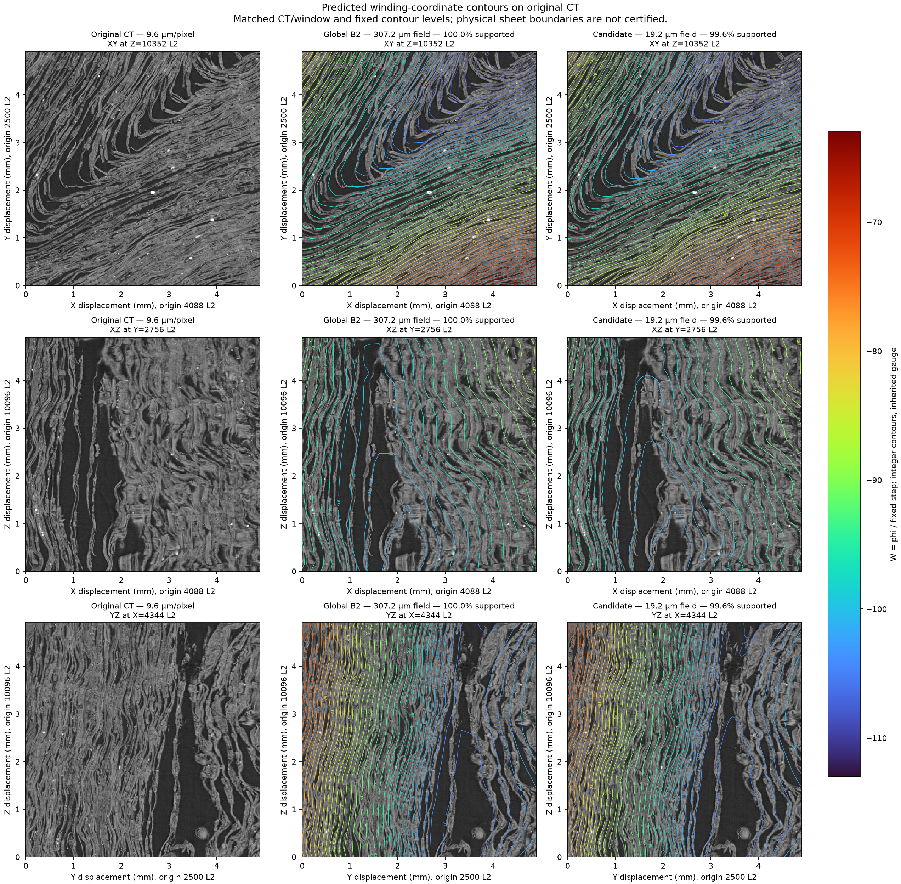

# Winding fields and reproducible evaluation

[](https://github.com/LimeGS/winding-field/actions/workflows/ci.yml)
[](#checks)
[](LICENSE)

[](assets/ct-winding.png)

*Paris4 CT at 9.6 µm/pixel, global B2 field at 307.2 µm and fine candidate at
19.2 µm. [Image attribution and terms](DATA.md#readme-illustration).*

Experimental software for constructing continuous winding-coordinate fields over
predicted scroll surfaces, and evaluating saved fields against a frozen case.
A useful field should remain nearly constant along a sheet while separating
adjacent sheets. Numerical convergence and CT overlays do not certify physical
sheet identity.

This repository contains the current implementation, reusable evaluation tools,
synthetic examples and regression tests. Research logs, run outputs, experiment
reports and prior release snapshots are maintained separately.

## The current method

We approach winding counting as the recovery of a continuous layer coordinate,
`W(x)`, over the scroll volume. Within a locally consistent region, this
coordinate should vary little when moving along a papyrus layer and increase by
approximately one when crossing to the next. Surfaces of constant `W` are then
candidates for following the paper, while differences in `W` estimate how many
layer spacings separate two locations. The absolute zero is a reference choice;
the useful information lies in relative ordering and calibrated spacing, rather
than in assigning an integer label to every voxel at the outset.

Surface-orientation predictions suggest the direction across layers, and a
layer-density estimate supplies the expected rate of change in that direction.
Traced fibres provide complementary evidence: samples believed to lie on the
same local layer should have similar coordinate values. These observations are
noisy and need not form a mutually consistent gradient field, so integrating
them independently along different paths can accumulate drift. Our approach
instead estimates a field jointly, balancing agreement with the local gradient
observations against variation along fibres. A shared coarse reference carries
a common origin and scale into finer regions, helping their local refinements
remain mutually consistent.

The open problem is making that coherence preserve the physical winding count.
A constant field has no within-layer drift, and a compressed field can improve
that metric while losing separation between neighbouring layers. Reliable
counting therefore also requires justified orientation and calibration,
validation of between-layer separation, and explicit treatment of missing
evidence. Folds, breaks and the topology of a rolled sheet can require cuts or
linked local coordinate patches rather than one globally smooth numbering.
We assess candidates through coverage, intrafibre drift, separation controls
and matched CT overlays; smooth contours or numerical convergence alone do not
establish that the inferred layers are physically correct.

<details>
<summary>Historical B2, fine pilot and cross-cohort measurements</summary>

## Historical fibre drift — versioned Paris4 cohorts

The B2 artifact re-evaluation on **October 14, 2026** reproduced the saved
global/fine measurements using the same frozen pairs and calibration. Drift is
`abs(phi(a) - phi(b)) / 1.192497988541921`, in **nominal sheet units**; distance
is **arclength along the fibre**, not the straight-line distance between endpoints.
Lower is better, but a constant field also has zero drift.

These are **all-eligible-fibre development results**, including fibres used in
fitting—not a blind test. Each eligible fibre contributes at most one pair per
distance bin; a fibre may appear in several bins. Statistics use covered pairs;
unavailable pairs remain in the selected denominator. Values are rounded to
three decimals.

The October 15 comparison keeps those historical results and adds the audited
October 13 `fibers.afv` snapshot. Each cohort is one complete AFV/SQLite file,
identified below by its hash. Changing the evaluation AFV changes the benchmark
population; it does not change the candidate field.

### A1. Historical B2 / AFV v1 — 307.2 µm field sampling

Evaluation fibres: **`Paris4_v1.afv`**

AFV SHA-256: `05fa4606d6403d5e3b417afd1d6c1def17cb4c42b598f6b18b17fe58ce347504`

**1,500,835 / 1,500,855 selected pairs covered.**

| Along-fibre span (mm) | Covered / selected pairs | Median | p90 | p99 |
|---|---:|---:|---:|---:|
| 0.5–1.5 | 508,949 / 508,958 | 0.435 | 1.273 | 3.134 |
| 1.5–2.5 | 404,915 / 404,921 | 0.584 | 1.819 | 4.927 |
| 2.5–3.5 | 264,985 / 264,988 | 0.700 | 2.245 | 6.129 |
| 3.5–5 | 172,300 / 172,302 | 0.821 | 2.639 | 7.100 |
| 5–7.5 | 93,790 / 93,790 | 0.975 | 3.175 | 8.195 |
| 7.5–10 | 36,978 / 36,978 | 1.145 | 3.795 | 9.180 |
| 10–15 | 15,413 / 15,413 | 1.326 | 4.289 | 10.177 |
| 15–20 | 2,836 / 2,836 | 1.573 | 5.267 | 11.896 |
| 20–25 | 550 / 550 | 1.707 | 6.071 | 12.738 |
| 25–30 | 100 / 100 | 1.827 | 6.471 | 15.688 |
| 30–45 | 19 / 19 | 1.769 | 7.853 | 10.151 |

The frozen `Paris4_v1.afv` contains 512,698 fibre traces: only 550 reach 20 mm,
100 reach 25 mm, and 19 reach 30 mm; the longest recorded trace is 44.706 mm.
These are traced lengths, not measurements of complete physical fibres. The
final evaluation uses no fibre-count cap. The longest bins therefore have sparse
samples, and their tail percentiles are not robust estimates. These results do
**not establish a long-distance drift plateau**.
In the separately reported reserved-fibre diagnostic, median drift is **1.372**
at 10–15 mm (2,886 covered pairs) and **2.040** at 20–25 mm (95 covered pairs).
That split alone does not establish spatial or pretraining independence.

### A2. Same historical B2 / AFV v2 — 307.2 µm field sampling

Evaluation fibres: **`fibers.afv`**, HTTP snapshot 2026-10-13 03:43:29 UTC

AFV SHA-256: `1898ff5098f03a36e02c76efc5f6b3774b766b154bfc8faadca488459114c941`

**2,154,184 / 2,154,184 selected pairs covered.** The B2 field, scale and scoring
rule are unchanged. AFV v2 uses a different tracer and covers z7000–17000 L2;
AFV v1 covers more of the scroll height. These are correlated automatic traces,
not newly independent human ground truth.

| Along-fibre span (mm) | Covered / selected pairs | Median | p90 | p99 |
|---|---:|---:|---:|---:|
| 0.5–1.5 | 913,491 / 913,491 | 0.318 | 0.920 | 2.257 |
| 1.5–2.5 | 367,547 / 367,547 | 0.498 | 1.486 | 4.707 |
| 2.5–3.5 | 237,948 / 237,948 | 0.637 | 1.900 | 6.263 |
| 3.5–5 | 182,354 / 182,354 | 0.778 | 2.297 | 7.226 |
| 5–7.5 | 137,923 / 137,923 | 0.986 | 2.876 | 8.383 |
| 7.5–10 | 100,837 / 100,837 | 1.256 | 3.650 | 9.547 |
| 10–15 | 79,017 / 79,017 | 1.586 | 4.570 | 10.238 |
| 15–20 | 53,270 / 53,270 | 2.088 | 5.916 | 11.272 |
| 20–25 | 37,796 / 37,796 | 2.582 | 7.038 | 12.027 |
| 25–30 | 25,978 / 25,978 | 2.957 | 8.108 | 12.709 |
| 30–45 | 18,023 / 18,023 | 3.367 | 9.370 | 13.611 |

<details>
<summary>A: same B2-linked fine pilot, both fibre cohorts — 19.2 µm</summary>

This is the local fine candidate shown in the cover, not another whole-scroll
result. Historical AFV v1: **596 / 638 selected pairs covered.**

Evaluation fibres: **`Paris4_v1.afv`**

AFV SHA-256: `05fa4606d6403d5e3b417afd1d6c1def17cb4c42b598f6b18b17fe58ce347504`

| Along-fibre span (mm) | Covered / selected pairs | Median | p90 | p99 |
|---|---:|---:|---:|---:|
| 0.5–1.5 | 249 / 272 | 0.192 | 0.592 | 0.901 |
| 1.5–2.5 | 169 / 178 | 0.270 | 0.660 | 1.209 |
| 2.5–3.5 | 109 / 110 | 0.407 | 0.857 | 1.190 |
| 3.5–5 | 59 / 64 | 0.464 | 0.926 | 1.205 |
| 5–7.5 | 8 / 12 | 0.250 | 1.068 | 1.192 |
| 7.5–10 | 2 / 2 | 0.742 | 0.787 | 0.797 |
| 10–45 | 0 / 0 | — | — | — |

There are no fine pairs spanning 10 mm or more. The 5–10 mm bins contain only
eight and two covered fibres, respectively; they do not support reliable tail
estimates. Different populations and domains mean this is not a matched
coarse-versus-fine improvement comparison.

The same fine field evaluated on AFV v2 covers **1,958 / 2,223 selected pairs**.

Evaluation fibres: **`fibers.afv`**, snapshot 2026-10-13

AFV SHA-256: `1898ff5098f03a36e02c76efc5f6b3774b766b154bfc8faadca488459114c941`

| Along-fibre span (mm) | Covered / selected pairs | Median | p90 | p99 |
|---|---:|---:|---:|---:|
| 0.5–1.5 | 965 / 1,040 | 0.243 | 0.604 | 1.050 |
| 1.5–2.5 | 413 / 454 | 0.357 | 0.906 | 1.376 |
| 2.5–3.5 | 295 / 323 | 0.423 | 1.012 | 1.497 |
| 3.5–5 | 215 / 238 | 0.531 | 1.128 | 1.563 |
| 5–7.5 | 67 / 165 | 0.736 | 1.492 | 1.905 |
| 7.5–10 | 3 / 3 | 1.248 | 1.450 | 1.495 |
| 10–45 | 0 / 0 | — | — | — |

The larger AFV still provides no >=10 mm pairs inside this fine domain. The
5–10 mm bins remain sparse and coverage must accompany the error percentiles.

</details>

**Separation controls:** global B2 matches **38/42** human development pairs
(MAE **0.254** nominal sheets). Constant and 0.1-compressed controls each match
**0/42**, despite lower fibre drift. The fine crop covers **0/42** human pairs,
so its human separation control is **not evaluated**, not a zero-accuracy result.
Physical sheet identity remains unverified.

### B. Controlled global construction with AFV v1 versus v2

Two new **all-input development controls** use the same cached observations,
593×256×256 grid, anchors, calibration and solver tolerance. Fibres are sampled
at 0.15 mm, with at most eight pairs per segment. Both constraint operators are
matched to the same total diagonal trace, **650,708**, before solving; the field
scale is not refitted. These controls are distinct from historical B2's fitting
split. Both fields are scored on the exact same frozen cases from A.

AFV v1, **`Paris4_v1.afv`** — SHA-256 `05fa4606d6403d5e3b417afd1d6c1def17cb4c42b598f6b18b17fe58ce347504`

AFV v2, **`fibers.afv`** — SHA-256 `1898ff5098f03a36e02c76efc5f6b3774b766b154bfc8faadca488459114c941`

Drift columns below refer to **20–25 mm**, in nominal sheets. All 42 human
development pairs are covered in both fields.

| Fitting AFV | Evaluation AFV | Median | p90 | p99 | Human exact | Human MAE |
|---|---|---:|---:|---:|---:|---:|
| v1 | v1 | 1.709 | 6.052 | 12.936 | 38/42 | 0.248 |
| v2 | v1 | 1.168 | 5.603 | 19.551 | 35/42 | 0.266 |
| v1 | v2 | 2.568 | 7.004 | 12.036 | 38/42 | 0.248 |
| v2 | v2 | 1.135 | 3.169 | 7.620 | 35/42 | 0.266 |

On the same v2 evaluation cohort, the 30–45 mm median also falls from **3.352 to
1.388**. This is a **tradeoff**, not an accepted replacement: human separation
accuracy regresses, and the v1 20–25 mm p99 worsens. Input coverage and constraint
placement change with the AFV, so this does not isolate tracer accuracy. There
is no independent holdout or physical-acceptance claim.

Field fitted with v1: `add7b645620b44ca0830036fd711636d67b7eeeb44b977139ebc076c3c5112cb`

Field fitted with v2: `ab3d3dc19d16eaac3ff7512aaa0ddfcc85ac3728c9cc594e03e07c8f7b2dd505`

<details>
<summary>Recorded field and result identities</summary>

| Artifact | SHA-256 |
|---|---|
| Original `Paris4_v1.afv` | `05fa4606d6403d5e3b417afd1d6c1def17cb4c42b598f6b18b17fe58ce347504` |
| New `fibers.afv` (2026-10-13) | `1898ff5098f03a36e02c76efc5f6b3774b766b154bfc8faadca488459114c941` |
| Frozen pair selection | `47af0a5d123208f7b928dcca2bf9c8774c147c22b71be991a127a3ccd6632eb5` |
| Global B2 field | `63203cd3754217193176835a0576bec321851a511d5b454cf34d95e4a8e20809` |
| Fine field | `4e013fdd616e9107064122d904296014d4d77488abc3cd925a844f7bc0c2bdd7` |
| Historical global summary (AFV v1) | `fe578ca203e1838ce7467921d146446fc80155809027d8e78d6a8164c036ae50` |
| Historical fine summary (AFV v1) | `6f612a77a0931fab626223164be292bf49aab05e70f7d014750b8211ac711046` |
| Same global B2, AFV v2 summary | `109879bae98f3b99178f3787e8275b085c2b98647de927d96d79f0050bdba923` |
| Same fine B2, AFV v2 summary | `8007dbf87d68d7030f5aba6fd7702f38dc9d437f976ec7f56b60b1470ca19ef4` |
| Archived run manifest | `15a3a5e5c18f830f30025509c22c7f7ba8b22717cfd8c2b5d78aa27a52ae04e2` |

Source data, frozen cases and per-pair receipts remain external. The
[benchmark guide](benchmarks/winding/README.md) documents the evaluation
contract; the offline synthetic demo does not reproduce these Paris4 numbers.

</details>

</details>

## Install

Target interpreters: Python 3.11 and 3.12 on Linux and macOS. CI is configured for
both Python versions on Linux. Tests run on CPU; GPU execution needs a compatible
CUDA installation. Process-supervision tools use Unix facilities.

```bash
python -m venv .venv && source .venv/bin/activate
python -m pip install -e ".[test,dev]"
```

Optional extras: `surface` for mesh/atlas tools, `data` for Zarr, `plot` for
Matplotlib, or `all` for the runtime/test features. Modules install flat
(`field_solver`, `physical_grid`, etc.); use a virtual environment to avoid name
collisions. The wheel contains `src/`; command-line tools live in the checkout.

## Minimal example

```bash
python -I examples/minimal_field.py
```

It solves and checks a synthetic ramp:

```text
converged: True
field[0,0,:]: [0.0, 1.0, 2.0, 3.0, 4.0, 5.0]
```

The main library interface is [`field_solver.solve_field`](src/field_solver.py).
It accepts NumPy arrays, nested sequences or PyTorch tensors and returns a NumPy
`float32` field plus a JSON-compatible receipt. Coordinates/gradients are XYZ;
arrays are ZYX. Defaults are CPU, unit spacing, `lam=3`, `rtol=1e-5`,
`maxiter=4000` and no reference penalty. Arguments are explicit; the solver reads
no configuration files. Fixed nodes take exact values, and without effective
anchors node zero fixes the gauge. Invalid inputs raise `ValueError`;
nonconvergence is reported in the receipt and must block publication.

## Generate and evaluate

### Build from a dataset configuration

```bash
python examples/build_demo.py --output /tmp/winding-build-demo
```

This offline example creates synthetic observations and fibres, writes a dataset
JSON, invokes the **real construction CLI**, and checks the resulting analytic
field. It requires no real scan or GPU. Its values are demonstration parameters,
not calibration for a real roll.

For your own data, supply an explicit configuration:

```bash
python tools/run_coherence.py global \
  --config /path/to/my-scroll.json --output /path/to/new-field
```

The default global method is B2; use `--stages` for other implemented variants.
The JSON selects the AFV, observation sources, coordinate transform, reconstruction
grid, fixed calibration and solver settings. Relative data paths resolve from the
JSON file. There is no scan-name registry, implicit AFV, machine-directory search
or inferred `/4` conversion. See the [configuration guide](DATASET.md) and the
[editable example](examples/dataset.example.json).

Without declared physical anchors, the generic solver uses a numerical zero
gauge. Black pixels on an arbitrary crop boundary are **not** automatically
exterior evidence. Supply a hash-bound fixed cache or explicitly identified
exterior faces when that boundary condition is justified.

### Try the complete benchmark offline

```bash
python examples/benchmark_demo.py --output /tmp/winding-benchmark-demo
```

Choose a new output directory each time. This creates a tiny synthetic case,
an analytic candidate and CT-like layer images, then runs the real evaluator.
No private data, model weights, GPU or network access is needed.

Expected final checks: **6/6 fibre pairs covered, 3/3 synthetic separation pairs
correct, and 0/3 for both collapse controls**. Open
`/tmp/winding-benchmark-demo/evaluation/ct-winding.png` for the overview, or
`TABLES.md` / `SUMMARY.json` alongside it for the scores. All demo tables and
images are labeled synthetic. These numbers illustrate the interface, not real
scroll performance.

### Evaluate supplied observations or predictions

The producer and evaluator communicate through saved artifacts:

```text
observations + constraints → producer → field.npy + metadata + optional support
                                          ↓
                              frozen case + evaluator
                                          ↓
                         metrics, controls, CT pictures, hashes
```

- [`tools/run_coherence.py`](tools/run_coherence.py) runs the current coherence
  methods on synthetic or supplied hash-bound data. Start with `--help`.
- [`benchmarks/winding/evaluate.py`](benchmarks/winding/evaluate.py) scores a
  saved candidate without importing the solver or PyTorch:

```bash
python benchmarks/winding/evaluate.py \
  --case "$CASE" --field "$FIELD" --metadata "$METADATA" \
  --output "$NEW_RUN"
```

Use `--check-only` with a separate new output directory for preflight. A case can
also request matched CT/winding pictures. See the
[benchmark guide](benchmarks/winding/README.md) for the case, candidate and visual
contracts. New cases declare the frame, physical units and native-to-world
transform explicitly. Historical cases lacking that information require an
explicit `--config` coordinate context, leaving their original files unchanged.
All/reserved populations, unavailable denominators and separation/collapse
controls remain explicit; missing human references are reported as not evaluated.

## Layout

| Path | Purpose |
|---|---|
| `src/` | Solver, constraints, physical grids, references, topology, data adapters and shared evaluation helpers |
| `benchmarks/winding/` | Current artifact evaluator, metrics, independent interpolation, CT renderer and tests |
| `tools/` | Coherence runner, supervision, error auditing and surface export/probe/atlas tools |
| `tests/` | Synthetic unit, integration and regression tests |
| `examples/` | Offline construction/evaluation demos and an editable dataset configuration |
| `.github/` | CI, dependency-update configuration and contribution templates |

## Checks

```bash
python -m pytest -q --cov=src --cov-report=term-missing
ruff format --check .
ruff check .
mypy
```

CI enforces a 90% statement-coverage floor across all `src/` modules. Mypy checks
annotated functions and a typed solver caller; unannotated research-function
bodies and array shapes/ranges still rely on runtime checks and tests.

The Audit badge reports the latest GitHub Actions push on `main`. The coverage
badge is a local snapshot from October 15, 2026: **512 tests passed, 91.29%
statement coverage**, on macOS with Python 3.11.13 / NumPy 2.2.6. Refresh it after
a measured change; it is not a live coverage feed.

## Data and contribution

Real CT, AFVs, model weights, coordinate annotations and evaluation runs are
external inputs/outputs; the README cover is the sole included real-data
illustration. The public tests generate synthetic fixtures. Follow
[DATA.md](DATA.md) for data handling and external terms; the project's
[MIT license](LICENSE) applies to repository-authored code, not external assets.

See [CONTRIBUTING.md](CONTRIBUTING.md) for development and compatibility rules,
and [SECURITY.md](SECURITY.md) for vulnerability reporting. Maintenance is
best-effort, with no release cadence or support SLA.
