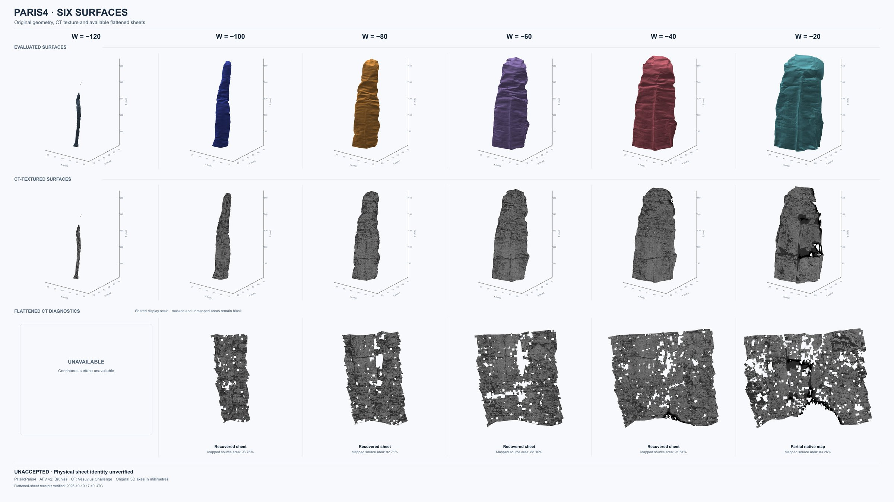
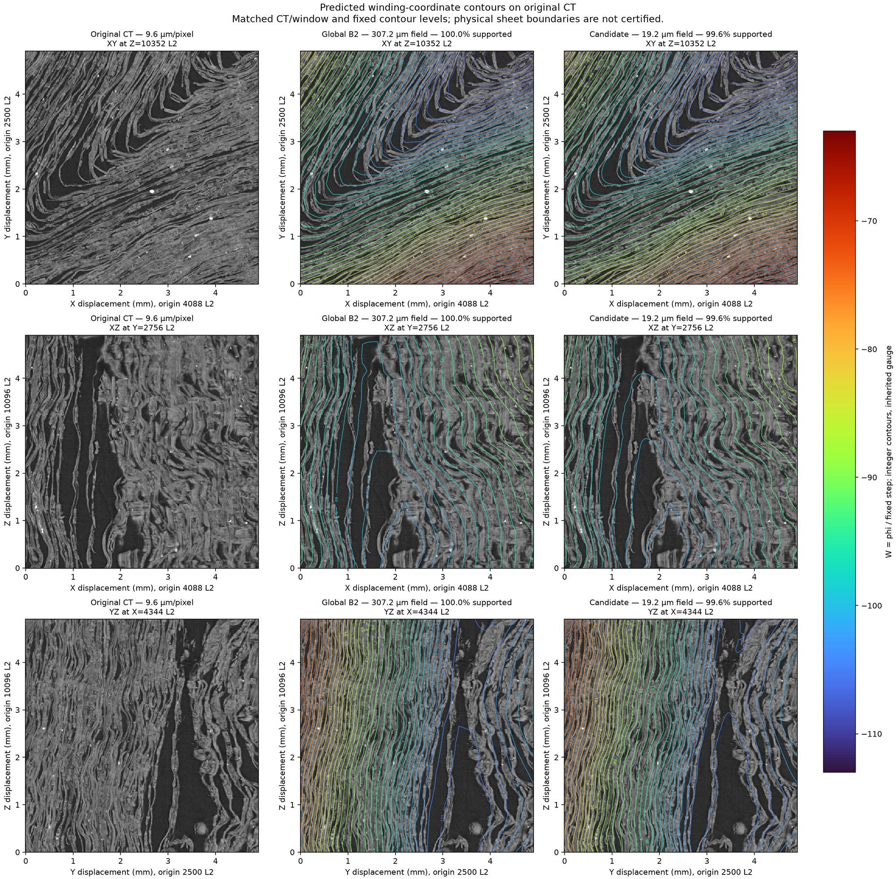

# winding-field

[](https://github.com/LimeGS/winding-field/actions/workflows/ci.yml)
[](#development)
[](LICENSE)
[](pyproject.toml)
[](https://github.com/LimeGS/winding-field/releases)

**Count the layers of a rolled papyrus scroll by solving for one continuous field.**

`winding-field` estimates a *winding field* `W(x)` over a CT scan of a
[Herculaneum scroll](https://scrollprize.org): a number that stays nearly constant
along each papyrus sheet and rises by about one per sheet crossed. Surfaces of
constant `W` follow the papyrus, so the field turns noisy local evidence (surface
orientation predictions and traced fibres) into a consistent layer ordering that
downstream tools can mesh, flatten and read.

[](assets/paris4-six-surfaces.png)

*Paris4 six-surface diagnostics. The continuous flattened surface at W = −120
is unavailable; masked and unmapped areas remain blank. Physical sheet identity
is unverified. [Image attribution and terms](DATA.md#readme-illustrations).*

## Where it fits

```text
CT scan ──► surface predictions + traced fibres ──► winding-field (this repo) ──► W(x)
                                                                                   │
                       meshes, flattened sheets, ink ◄── winding-field-cli ◄──────┘
```

This repository is the **numerical core**: the field solver, block-wise solves with
resumable storage, fibre constraints, and a reproducible evaluator.
The end-to-end command line (from CT to meshes and flattened CT) lives in
[`winding-field-cli`](https://github.com/LimeGS/winding-field-cli).

> **Status: research software.** Numerical convergence and CT overlays do not prove
> physical sheet identity; results are diagnostics, not validated readings. See
> [Method](docs/METHOD.md) for what is solved and what remains open, and
> [Results](docs/RESULTS.md) for the latest measurement.

## Quick start

Python 3.11 or 3.12 on Linux or macOS (CUDA optional).

```bash
git clone https://github.com/LimeGS/winding-field.git
cd winding-field
python3.11 -m venv .venv && source .venv/bin/activate
python -m pip install -e ".[test,dev]"
python -I examples/minimal_field.py
```

Expected output, a solved synthetic ramp:

```text
converged: True
field[0,0,:]: [0.0, 1.0, 2.0, 3.0, 4.0, 5.0]
```

Extras: `data` (Zarr), `test`, `dev`, or `all`.

## Use it

| I want to… | Start here |
|---|---|
| Solve a field from arrays (NumPy or PyTorch) | [`field_solver.solve_field`](src/field_solver.py); arrays are ZYX, coordinates and gradients XYZ |
| Solve large volumes block by block, with resume | [`block_solver.solve_blocks`](src/block_solver.py), [`field_store.BlockStore`](src/field_store.py), [fibre constraints](src/constraint_templates.py) |
| Build a field from my own data | [Dataset configuration](DATASET.md) and `tools/run_coherence.py` |
| Score a saved field against a frozen case | [Benchmark guide](benchmarks/winding/README.md) |
| Get meshes, renders or flattened CT | [`winding-field-cli`](https://github.com/LimeGS/winding-field-cli#quick-start) |

Offline demos, no scan, GPU or network needed (use a new output directory each time):

```bash
python examples/build_demo.py --output /tmp/winding-build-demo          # dataset JSON → B2 field → analytic check
python examples/benchmark_demo.py --output /tmp/winding-benchmark-demo  # synthetic case → real evaluator
```

The benchmark demo ends with **6/6 fibre pairs covered, 3/3 separation pairs correct
and 0/3 for both collapse controls**; the numbers illustrate the interface, not
real scroll performance.

<details>
<summary>Building from your own data and evaluating candidates</summary>

```bash
python tools/run_coherence.py global \
  --config /path/to/my-scroll.json --output /path/to/new-field
```

The default global method is B2; use `--stages` for other implemented variants.
The JSON selects the AFV, observation sources, coordinate transform, reconstruction
grid, fixed calibration and solver settings; relative paths resolve from the JSON
file. There is no scan-name registry, implicit AFV, machine-directory search or
inferred `/4` conversion. See the [configuration guide](DATASET.md) and the
[editable example](examples/dataset.example.json).

Without declared physical anchors, the generic solver uses a numerical zero gauge.
Black pixels on an arbitrary crop boundary are **not** automatically exterior
evidence: supply a hash-bound fixed cache or explicitly identified exterior faces
when that boundary condition is justified.

Producer and evaluator communicate only through saved artifacts:

```text
observations + constraints → producer → field.npy + metadata + optional support
                                          ↓
                              frozen case + evaluator → metrics, controls, hashes
```

```bash
python benchmarks/winding/evaluate.py \
  --case "$CASE" --field "$FIELD" --metadata "$METADATA" --output "$NEW_RUN"
```

The evaluator imports neither the solver nor PyTorch. Use `--check-only` with a
separate new output directory for preflight. New cases declare the frame, physical
units and native-to-world transform; historical cases need an explicit `--config`
coordinate context. All/reserved populations, unavailable denominators and
separation/collapse controls stay explicit; missing human references are reported as
not evaluated. Matched CT/winding pictures come from `winding-field ct-visuals` in
the CLI.

</details>

[](assets/ct-winding.png)

*Earlier Paris4 CT/winding overlay: CT at 9.6 µm/pixel, the global B2 field at
307.2 µm and a local fine pilot at 19.2 µm. This illustration is separate from
the [fine-band measurement](docs/RESULTS.md).
[Image attribution and terms](DATA.md#readme-illustrations).*

## Documentation

- [Method and glossary](docs/METHOD.md): what a winding field is and the open problems.
- [Results](docs/RESULTS.md): latest Paris4 fine-grid drift measurement.
- [All documentation](docs/README.md), including data terms, migration from
  `winding-field-experiments` and developer notes.

## Repository layout

| Path | Contents |
|---|---|
| `src/` | Solver, constraints, physical grids, bounded storage and block execution, observation preparation, references, topology, data adapters |
| `benchmarks/winding/` | Artifact evaluator, metrics, independent interpolation and tests |
| `tools/` | Field-construction research runners, error auditing, `verify.py` |
| `examples/` | Offline demos and editable dataset configurations |
| `tests/` | Synthetic unit, integration and regression tests |
| `docs/` | Method, results, migration and developer notes |

## Development

```bash
python -m pytest -q --cov=src --cov-report=term-missing
ruff format --check . && ruff check . && mypy
python tools/verify.py   # API, golden outputs and resume vs main; see REVIEW.md
```

CI enforces 90% statement coverage over `src/` and runs the base branch's verifier on
every pull request. The coverage badge is a local snapshot (November 4, 2026: 1297
tests, 92.54%), not a live feed. Solver throughput work is recorded in the
[developer notes](docs/dev/README.md).

Changes are listed in the [changelog](CHANGELOG.md).

## Contributing and data

Contributions are welcome: read [CONTRIBUTING.md](CONTRIBUTING.md) and the
[code of conduct](CODE_OF_CONDUCT.md). Real CT, AFVs, model weights, coordinate
annotations and evaluation runs are external; the two README illustrations are the
only included CT-derived images. Follow [DATA.md](DATA.md) for data handling and
external terms; the [MIT license](LICENSE) covers repository-authored code, not
external assets. Report vulnerabilities as described in [SECURITY.md](SECURITY.md).
Maintenance is best-effort, with no release cadence or support SLA.

## Related projects

Part of the LimeGS toolchain for the [Vesuvius Challenge](https://scrollprize.org):

- [winding-field-cli](https://github.com/LimeGS/winding-field-cli): end-to-end CLI from CT to fibres, winding field, meshes and flattened charts.
- [ink-sdk](https://github.com/LimeGS/ink-sdk): standalone ink inference on surface volumes, or on tifxyz meshes plus CT.
- [helena-framework](https://github.com/LimeGS/helena-framework): reproducible, auditable orchestration of the volume → surface → ink → page pipeline.
- [herculaneum-legibility-index](https://github.com/LimeGS/herculaneum-legibility-index): legibility triage over the official ink maps.
- [herculaneum-legibility-v5](https://github.com/LimeGS/herculaneum-legibility-v5): corrected-label retraining of the legibility classifier.
- [vesuvius-chat](https://github.com/LimeGS/vesuvius-chat): search the Discord research archive from a web chat or an AI agent.

## Citation

If you use this work, please cite it with the metadata in [CITATION.cff](CITATION.cff) (GitHub's **Cite this repository** button reads it).
